  

  I build mobile apps with Flutter and Dart, using Bloc/Cubit, REST APIs, Firebase and clean architecture.

  <a href="https://youssefesmail.figma.site"><b>Portfolio</b></a> &nbsp;·&nbsp;
  <a href="https://www.linkedin.com/in/yosefesmail/"><b>LinkedIn</b></a> &nbsp;·&nbsp;
  <a href="mailto:youssefemail19@gmail.com"><b>Email</b></a>

 

<h2 align="center">Selected work</h2>

   
  <code>Flutter</code> <code>Bloc</code> <code>Firebase</code> <code>REST</code>

   
  <code>Flutter</code> <code>Dart</code> <code>Provider</code>

   
  <code>Flutter</code> <code>Dart</code> <code>Bloc</code> <code>Firebase</code>

   
  <code>Python</code> <code>LangGraph</code> <code>RAG</code>

