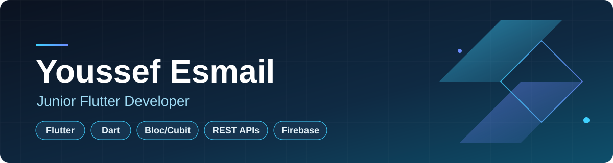

  

  I build mobile apps with Flutter and Dart, using Bloc/Cubit, REST APIs, Firebase and clean architecture.

  <a href="https://youssefesmail.figma.site"><b>Portfolio</b></a> &nbsp;•&nbsp;
  <a href="https://www.linkedin.com/in/yosefesmail/"><b>LinkedIn</b></a> &nbsp;•&nbsp;
  <a href="mailto:youssefemail19@gmail.com"><b>Email</b></a>

## Selected projects

<table>
  <tr>
    <td width="50%" valign="top">
      <h3><a href="https://github.com/Som3a-developer/health_app">FitLife app</a></h3>
      Flutter app for tracking calories, meals, goals and progress.  
      <code>Flutter</code> <code>Dart</code> <code>Provider</code>
    </td>
    <td width="50%" valign="top">
      <h3><a href="https://github.com/Som3a-developer/Graduation-Project">Healthy lifestyle backend</a></h3>
      Node.js, Express and MySQL API for a healthy lifestyle app.  
      <code>Node.js</code> <code>Express</code> <code>MySQL</code>
    </td>
  </tr>
  <tr>
    <td width="50%" valign="top">
      <h3><a href="https://github.com/Som3a-developer/book_store">Book Space</a></h3>
      Flutter graduation project with admin book management, favorites and a library. UI based on a Behance design.  
      <code>Flutter</code> <code>Dart</code>
    </td>
    <td width="50%" valign="top">
      <h3><a href="https://github.com/Som3a-developer/ai_recruitment">AI Recruitment</a></h3>
      Academic project using LangGraph, RAG and FAISS to evaluate candidates.  
      <code>Python</code> <code>LangGraph</code> <code>RAG</code> <code>FAISS</code>
    </td>
  </tr>
</table>

  <a href="https://youssefesmail.figma.site">youssefesmail.figma.site</a> &nbsp;•&nbsp;
  <a href="https://www.linkedin.com/in/yosefesmail/">linkedin.com/in/yosefesmail</a> &nbsp;•&nbsp;
  <a href="mailto:youssefemail19@gmail.com">youssefemail19@gmail.com</a>

